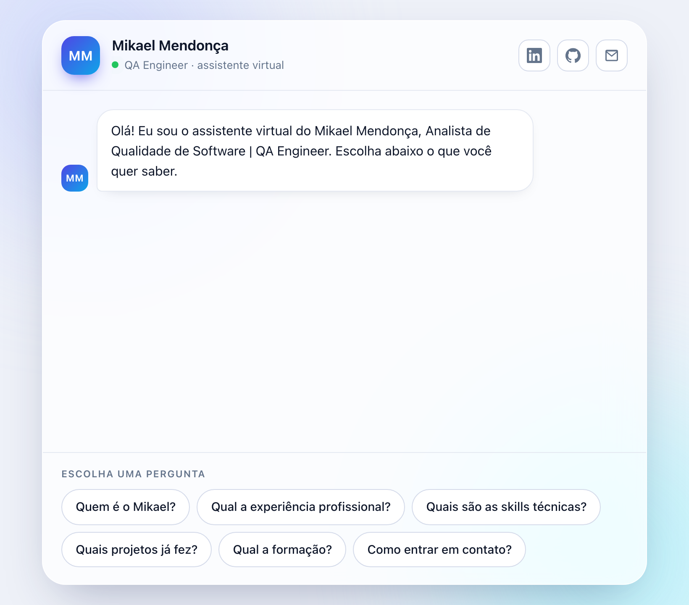

# Chatbot de Portfólio

[](https://github.com/Mikaelmendonca/chatbot-portfolio-typescript/actions/workflows/ci.yml)

Chatbot de portfólio em **TypeScript puro**: sem servidor, sem IA e sem custo. O visitante navega por um menu de perguntas prontas, sem campo de digitação, e roda inteiro no navegador.

🔗 **Demo:** mikaelmendonca.github.io/chatbot-portfolio-typescript/



## Como funciona

Cada pergunta é um botão. Cada resposta vem de [src/profile.ts](src/profile.ts) — os dados do meu currículo — e traz novos botões relacionados, formando uma pequena árvore de diálogo. Não há campo de texto livre: o visitante nunca digita nada, o que elimina qualquer risco de injeção de conteúdo e mantém a conversa sempre dentro do roteiro.

## Stack

- **TypeScript** compilado para JavaScript puro, sem framework e sem dependências em produção.
- **HTML/CSS** responsivo, com tema claro e escuro (`prefers-color-scheme`).
- **Testes unitários** com o test runner nativo do Node (`node:test`).
- **Testes E2E** com **Python + Playwright**, cobrindo navegação, links, privacidade e responsividade.
- **CI** no GitHub Actions: a cada push, builda, roda os testes unitários e a suíte E2E completa.

## Rodando localmente

Pré-requisitos: [Node.js](https://nodejs.org) 18+.

```bash
npm install
npm run dev
```

Abra **http://localhost:4173**. O comando `dev` já compila o TypeScript antes de subir o servidor estático (`scripts/serve.mjs`, sem dependências).

Para só compilar:

```bash
npm run build
```

## Testes

### Unitários (TypeScript)

Testam a lógica de respostas do bot: cada botão leva a uma resposta que existe, todos os nós são alcançáveis a partir da tela inicial, os dados batem com o currículo e o telefone nunca aparece em nenhuma resposta.

```bash
npm test
```

### End-to-end (Python + Playwright)

Testam o app pelo navegador de verdade: clique nos botões, veja a resposta, confira o link. Ficam em [e2e/](e2e).

```bash
cd e2e
python3 -m venv .venv
source .venv/bin/activate      # Windows: .venv\Scripts\activate
pip install -r requirements.txt
playwright install chromium
pytest -v
```

Não é preciso subir o site à parte: se `http://localhost:4173` não estiver no ar, a fixture `servidor` em [conftest.py](e2e/conftest.py) sobe o servidor sozinha para a sessão de testes (e usa o build que já existir em `public/js` — rode `npm run build` antes se tiver mexido no código).

## Estrutura

```
src/
  profile.ts   → dados do currículo (única fonte de conteúdo do bot)
  bot.ts       → árvore de diálogo: botões, respostas e navegação
  main.ts      → interface: renderiza mensagens, opções e o "digitando"
public/        → HTML, CSS e o JavaScript já compilado (é o que vai para o ar)
e2e/           → suíte de testes Python + Playwright
.github/workflows/ci.yml → build + testes a cada push
```

## Deploy

O site é 100% estático: é só publicar a pasta `public/`. Sem servidor, sem variável de ambiente, sem custo.

- **GitHub Pages:** em Settings → Pages, publique a partir da pasta `public/` na branch `main`.
- **Netlify / Vercel:** aponte o diretório de publicação (*publish directory*) para `public/`, sem comando de build.

Depois do deploy, atualize duas coisas com a URL final:
1. O link da demo, no topo deste README.
2. As tags `og:url` e `og:image` em [public/index.html](public/index.html), para o link ter uma prévia bonita quando compartilhado.

## Licença

[MIT](LICENSE)
